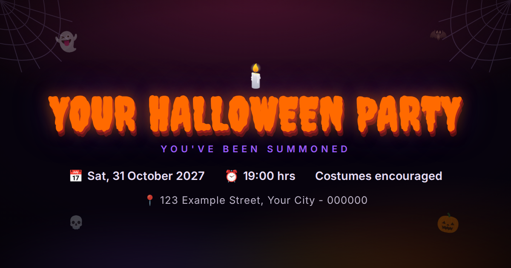

# 🎃 Spooky Invite

[](https://render.com/deploy?repo=https://github.com/dscalvin97/spooky-invite)
[](https://vercel.com/new/clone?repository-url=https://github.com/dscalvin97/spooky-invite)

[](https://github.com/dscalvin97/spooky-invite/actions/workflows/ci.yml)
[](LICENSE)


*Railway users: New Project → deploy from this repo, then attach a persistent disk at `/data`. (No one-click button: Railway's requires publishing this repo as a Railway template, which only the owner can do.)*

A one-page Halloween party invite that gets **spookier as the party approaches**.
Zero npm dependencies: one `index.html`, one `server.js`, Node's standard library only.



## What you get

- **Countdown** to party time, with digits that heat from green to shaking blood-red as the night nears
- **Escalating creepiness** in 5 tiers driven by hours-to-party: fog thickens, cobwebs grow, the sky bleeds red, critters multiply, the title starts breathing
- **Scroll haunts**: sections rise from the grave, the crypt darkens as you descend, the dead rise from the bottom edge, a ghost fly-bys the RSVP form
- **Google-free map** (Leaflet + OSM, dark-themed) showing how to get to the lair
- **RSVPs stored in SQLite** (via Node's built-in `node:sqlite`, still zero npm dependencies): atomic and crash-safe, survives restarts and reboots, timestamps every RSVP. Old flat-file `rsvp.json` data is migrated automatically on first boot. Live guest list on the page.
- **The Race of the Dead**: on party day only (±12h around start time), guests who open the page on their phone and share location show up as live 👻 markers with a solid line showing their shortest walking path to your door. The server rejects location pings outside that window, so there is **no tracking any other day of the year**.
- OG image + meta tags so WhatsApp/Instagram shares get a proper spooky card

## Quickstart

Requires Node 24+ (for the built-in SQLite module).

```bash
git clone <your-fork-url> && cd spooky-invite
cp config.example.json config.json   # then edit it
node server.js                       # http://localhost:3000
```

## config.json

| key | what it controls |
|---|---|
| `title` | page title, h1, OG title |
| `tagline` | the line under the title |
| `datetime` | ISO date/time with timezone; drives the countdown **and** the race window (±12h) |
| `dateRow`, `timeRow` | the two detail lines on the invite |
| `address` | shown on the invite and the map popup (also feeds the Google Maps directions link) |
| `venue` | `[lat, lng]` map pin. Find yours at openstreetmap.org |
| `costumeRow` | the costume line. Be nicer than "mandatory" |
| `url` | public URL of your deployment; used in OG tags |
| `ogDescription` | what WhatsApp/Instagram shows under the title |

`config.json` is gitignored so your real address never gets committed. Restart
the server after editing it (config is applied at boot).

## The share card

`og.html` is the 1200x630 card source. Edit its text for your party, then:

```bash
google-chrome --headless --screenshot=og.png --window-size=1200,630 \
  --hide-scrollbars --virtual-time-budget=8000 "file://$PWD/og.html"
```

Note: WhatsApp caches link previews aggressively; if the preview looks stale,
scrape the URL once with Facebook's Sharing Debugger to force a refresh.

## Deploying

Pick your platform. With a disk and a long-running process anywhere (Docker,
VPS, PaaS) it runs exactly as designed; on serverless (Vercel) storage moves to
Upstash and the live stream degrades to polling.

### Docker (any VPS, home server, NAS)

```bash
cp config.example.json config.json   # edit it
docker compose up -d --build
```

RSVPs persist in the `invite-data` volume (`/data/rsvp.db` in the container).
Done. Put whatever TLS terminator you like in front (nginx, traefik, caddy).

### Bare-metal VPS (nginx + systemd + certbot)

The recipe below was run and verified on Ubuntu with Node 26 and nginx.

1. **Run it under systemd** so it survives reboots and crashes
   (`/etc/systemd/system/halloween.service`):

   ```ini
   [Unit]
   Description=Spooky invite
   After=network.target

   [Service]
   User=youruser
   WorkingDirectory=/opt/spooky-invite
   ExecStart=/usr/bin/node /opt/spooky-invite/server.js
   Environment=PORT=3031
   Restart=always

   [Install]
   WantedBy=multi-user.target
   ```

   ```bash
   sudo systemctl enable --now halloween
   ```

2. **nginx** in front (`/etc/nginx/sites-available/spooky`), SSE needs
   `proxy_buffering off`:

   ```nginx
   server {
       listen 80;
       server_name your.domain.example;
       location / {
           proxy_pass http://127.0.0.1:3031;
           proxy_http_version 1.1;
           proxy_set_header Host $host;
           proxy_buffering off;
       }
   }
   ```

3. **TLS**: point your domain's A record at the server, then
   `sudo certbot --nginx -d your.domain.example`.

### PaaS (Railway, Render, Fly.io)

They all work, since the app is just Node + a file:

- deploy from GitHub using the included `Dockerfile`
- attach a **persistent disk mounted at `/data`** (RSVPs live in `/data/rsvp.db`;
  without a disk, guest lists reset on every redeploy)
- expose your `config.json` as a file at `/app/config.json` (bake it into a
  private image, or mount it)
- the `PORT` env var is already respected for platforms that inject one

### Vercel (serverless)

Supported, with two moving parts swapped for their equivalents (button at the
top of this README):

1. Create a free [Upstash](https://upstash.com) Redis database (REST, any region)
2. Set two env vars on the Vercel project: `UPSTASH_REDIS_REST_URL` and `UPSTASH_REDIS_REST_TOKEN`
3. Set your party config as one env var, `PARTY_CONFIG` (the JSON from `config.example.json`, single line), since serverless filesystems are read-only
4. Deploy

What changes under the hood: RSVPs and race pings go to Upstash instead of
`rsvp.db` (ping hash carries a 12h TTL and only exists inside the race window,
same privacy rule as everywhere), and when the platform cuts the live event
stream, the page silently switches to polling every 5 seconds. Everything else
is identical.

### Not supported: other serverless (Netlify, Cloudflare Workers)

Netlify's function runtime and Cloudflare's Workers runtime can't run this
app's Node internals (`node:sqlite`, raw HTTP streaming semantics) without a
rewrite onto vendor-specific services. Vercel covers the serverless case; for
anything else, use a container or a small VM.

## Party-night notes (read before the 31st)

- Guests must open the link **on their phone** and allow location; desktops
  usually have no GPS. The tab must stay open while they travel.
- Routes come from the public OSRM demo server (free, no key). If it rate-limits,
  routes skip silently; live markers are unaffected.
- RSVPs live in `rsvp.db` (SQLite, WAL mode). It survives restarts, reboots and
  even a `kill -9` mid-write; back up that one file and you have every RSVP.
  Live locations deliberately do not persist: memory only, race window only.

## Customizing the spookiness

- **Escalation tiers**: `body.spooky-1` … `spooky-4` in `index.html` (hours-to-party
  thresholds in the JS below the countdown)
- **Colors**: the `:root` palette at the top of the stylesheet
- **Scroll effects**: the `--scroll` CSS variable + the IntersectionObserver block
- **Map night-mode**: the tile-pane filter line in the map setup

## License

MIT. Have a good party.
